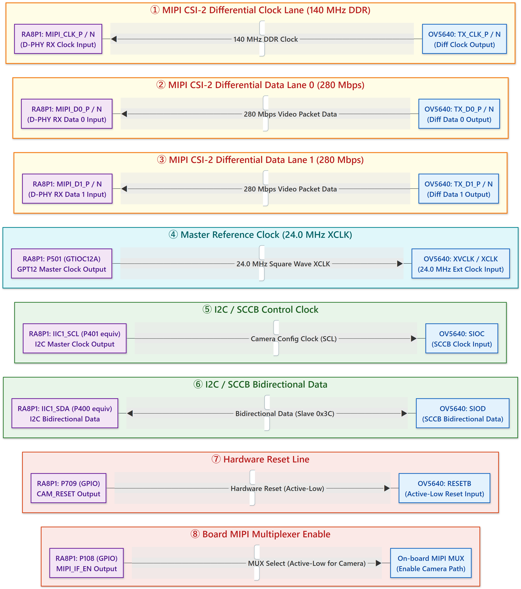

# Renesas EK-RA8P1 with Zephyr RTOS: Real-Time Edge AI & Multimedia Pipeline

[](https://www.zephyrproject.org/)
[-0055A5.svg)](https://www.renesas.com/products/microcontrollers-microprocessors/ra-cortex-m-mcus/ra8p1-high-performance-1000mhz-arm-cortex-m85-microcontrollers)
[](https://www.arm.com/products/silicon-ip-cpu/ethos/ethos-u55)
[](LICENSE.md)

A production-grade, native **Zephyr RTOS** edge AI and multimedia demonstration suite developed for the **Renesas EK-RA8P1** evaluation kit (Arm Cortex-M85 @ 1.0 GHz, Arm Ethos-U55 microNPU, and TES D/AVE 2D hardware graphics accelerator).

This repository features real-time 2-lane MIPI-CSI2 camera video capture, sub-millisecond on-device acoustic keyword spotting, and ultra-fast 8 ms YOLO face detection.

📄 **[日本語マニュアル (README_ja.md)](README_ja.md)**

---

## 🎬 YouTube Demo Videos & System Showcase

Watch the real-time hardware execution demonstrations on YouTube by clicking the thumbnails or video links below:

### 1. MIPI-CSI2 Camera Streaming & Hardware GPU Upscaling
Captures high-frame-rate video from an OmniVision OV5640 CMOS image sensor across a 2-lane MIPI-CSI2 link. TES D/AVE 2D hardware engine provides real-time bilinear texture upscaling (320×240 $\rightarrow$ 800×600) directly to a 1024×600 LCD panel with zero frame tearing and zero CPU load.

| YouTube Demo Video (Click to Watch) | Hardware Setup & System Layout |
| :---: | :---: |
| [](https://youtu.be/TST9BuLZz5A)<br>🎥 [**Watch on YouTube: TST9BuLZz5A**](https://youtu.be/TST9BuLZz5A) | .png) |

.png)

---

### 2. YOLOv5-Face Ultra-Fast Detection on Arm Ethos-U55 NPU (8 ms)
Performs real-time face detection on incoming MIPI camera frames utilizing the integrated **Arm Ethos-U55 microNPU** in **just 8 ms** (an 11.4× speedup over the Cortex-M85 CPU). Displays bounding boxes, confidence tags, and a permanent latency HUD at a rock-solid 48 FPS.

| YouTube Demo Video (Click to Watch) | System Architecture Block Diagram |
| :---: | :---: |
| [](https://youtu.be/agK5VNgjKHI)<br>🎥 [**Watch on YouTube: agK5VNgjKHI**](https://youtu.be/agK5VNgjKHI) | .png) |

.png)

---

### 3. PDM Digital Microphone Voice Keyword Spotting on NPU (0.25 ms)
Captures acoustic audio at 32 kHz 20-bit precision from the onboard PDM digital microphone via background DMAC. CMSIS-DSP extracts MFCC features, and the Arm Ethos-U55 microNPU completes neural network inference in **only 0.25 ms (249 μs)** across 5 classes (`up`, `down`, `left`, `right`, `noise`). Real-time oscilloscope waveform and confidence meters are drawn on the LCD.

| YouTube Demo Video (Click to Watch) | System Architecture Block Diagram |
| :---: | :---: |
| [](https://youtu.be/0KgvTPK1UMA)<br>🎥 [**Watch on YouTube: 0KgvTPK1UMA**](https://youtu.be/0KgvTPK1UMA) | .png) |

.png)

---

## ⚡ Hardware Benchmark Results: NPU vs. CPU

Executing neural network workloads on the dedicated Arm Ethos-U55 microNPU delivers an **11× to 14× speedup** compared to running on the 1.0 GHz Arm Cortex-M85 CPU alone, freeing CPU bandwidth for application logic and display management.

| Application / Task | Processing Core | Inference Latency | Display Rate / FPS | Acceleration Factor |
| :--- | :--- | :---: | :---: | :---: |
| **YOLO Face Detection** ([`yoloface_npu`](yoloface_npu/)) | **Arm Ethos-U55 NPU** | **8.0 ms** | **48 FPS (GPU Blit)** | **11.4× Faster** |
| YOLO Face Detection ([`yoloface_cpu`](yoloface_cpu/)) | Arm Cortex-M85 CPU | 91.0 ms | 10 FPS | Baseline (1.0×) |
| **Voice Keyword Spotting** ([`pdm_npu`](pdm_npu/)) | **Arm Ethos-U55 NPU** | **0.25 ms (249 μs)** | **60 FPS Scope** | **14.4× Faster** |
| Voice Keyword Spotting ([`pdm_cpu`](pdm_cpu/)) | Arm Cortex-M85 CPU | 3.6 ms | 60 FPS Scope | Baseline (1.0×) |
| **MIPI Camera Streaming** ([`mipi_csi2`](mipi_csi2/)) | **VIN DMA + D/AVE 2D** | **0 ms (Zero-Copy)** | **48–50 FPS** | Dedicated Hardware |

---

## 📁 Repository Structure

```text
zephyr/
├── img/                  # Presentation slides, block diagrams, and hardware photos
├── mipi_csi2/            # 2-lane MIPI-CSI2 (OV5640) video streaming & D/AVE 2D upscaling
├── yoloface_npu/         # YOLO Face Detection on Arm Ethos-U55 NPU (8 ms)
├── yoloface_cpu/         # YOLO Face Detection benchmark on Cortex-M85 CPU (91 ms)
├── pdm_npu/              # PDM Voice Keyword Spotting on Ethos-U55 NPU (0.25 ms)
├── pdm_cpu/              # PDM Voice Keyword Spotting benchmark on CPU (3.6 ms)
├── pdm_mic/              # PDM digital microphone fundamental driver & DMA test
├── d2_test/              # TES D/AVE 2D (DRW) graphics acceleration test
├── .gitignore            # Git exclusion rules for Zephyr / CMake builds
├── LICENSE.md            # Open-source license terms
├── README.md             # Top-level English documentation (this file)
└── README_ja.md          # Top-level Japanese documentation
```

Each subproject contains its own detailed `README.md` and `README_ja.md` documenting peripheral configuration, interrupt vectors, and memory allocations.

---

## 🛠️ Hardware Specification & Pin Interconnect

### Key Hardware Specifications
* **MCU Target**: Renesas EK-RA8P1 (R7FA8P1AHECBD)
  * CPU: Arm Cortex-M85 running at 1.0 GHz (Helium MVE-F, 32KB I-cache / 32KB D-cache)
  * NPU: Arm Ethos-U55 microNPU (up to 480 MHz)
  * 2D GPU: TES D/AVE 2D (DRW) hardware graphics accelerator
  * Memory: 2MB On-Chip MRAM/Flash, 1MB Internal SRAM (SRAM0: 512KB, SRAM1: 512KB)
  * External Memory: 64MB SDRAM (`0x68000000`, 32-bit bus width)
* **Camera Module**: OmniVision OV5640 5MP CMOS Sensor
  * Physical Link: 2-lane MIPI CSI-2 + 1 Differential Clock Lane
  * Clock Speed: 140 MHz DDR (280 Mbps/lane $\rightarrow$ 560 Mbps aggregate physical bandwidth)
  * Master Reference Clock: 24.0 MHz XCLK generated by GPT12 (`P501`)
  * Control Bus: IIC1 (`P400`/`P401` as SCCB master)
* **Acoustic Sensor**: Onboard PDM Stereo Digital Microphone (Unit 0, Channel 2)
  * Clock: `P812` (`MIC_CLK`)
  * Data: `P502` (`MIC_DAT`)
* **Display**: 1024×600 TFT-LCD (GLCDC 16-bit RGB565 via triple framebuffers in SDRAM)

### MIPI-CSI2 Signal Interconnect Diagram


---

## 🚀 Build & Flash Instructions

### Prerequisites
* **Operating System**: Windows 10 / 11, Linux, or macOS
* **Zephyr Environment**: Zephyr SDK v0.16.x or newer with `west` toolchain
* **Debug Probe**: SEGGER J-Link v7.90 or newer (compatible with onboard J-Link OB)

### One-Click Build & Flash (Windows Batch)
Each project includes standalone batch scripts for fast, turnkey building and flashing.

Example: Building and flashing `yoloface_npu`:
```cmd
cd yoloface_npu

:: Build the project using west
build.bat

:: Program to RA8P1 flash memory via J-Link
flash.bat
```

### Manual Command-Line Build
```bash
# Navigate to the target project directory
cd yoloface_npu

# Pristine build for Renesas EK-RA8P1
west build -p always -b renesas_ra8p1_ek .

# Flash binary via J-Link
west flash
```

---

## 📜 License

This project is licensed under multiple open-source licenses depending on the component. See [LICENSE.md](LICENSE.md) for full details.

* **Application Logic**: [MIT License](LICENSE.md)
* **Zephyr RTOS**: [Apache License 2.0](https://github.com/zephyrproject-rtos/zephyr/blob/main/LICENSE)
* **Renesas FSP Drivers & D/AVE 2D**: Renesas FSP License / TES Electronic Solutions
* **Arm Ethos-U Core Driver & CMSIS**: [Apache License 2.0](http://www.apache.org/licenses/LICENSE-2.0)
* **Edge Impulse SDK & TFLM**: [Apache License 2.0 / BSD 3-Clause Clear](https://github.com/edgeimpulse/inferencing-sdk-cpp/blob/master/LICENSE)
