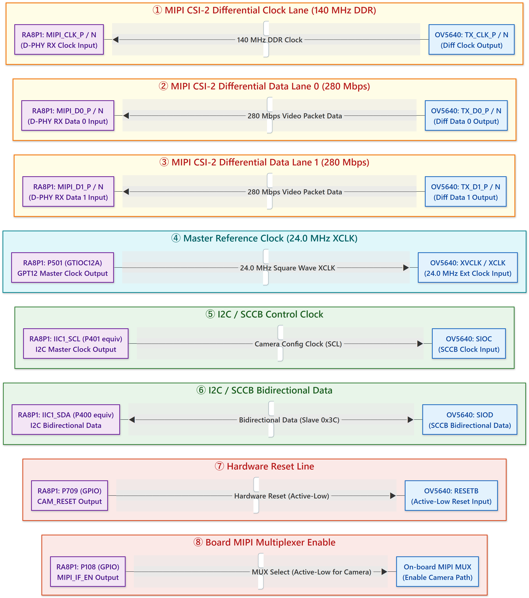

# Renesas EK-RA8P1 × Zephyr RTOS: エッジAI & マルチメディア・システム

[](https://www.zephyrproject.org/)
[-0055A5.svg)](https://www.renesas.com/products/microcontrollers-microprocessors/ra-cortex-m-mcus/ra8p1-high-performance-1000mhz-arm-cortex-m85-microcontrollers)
[](https://www.arm.com/products/silicon-ip-cpu/ethos/ethos-u55)
[](LICENSE.md)

本リポジトリは、ルネサス エレクトロニクス製フラッグシップ・マイコン **EK-RA8P1**（Arm Cortex-M85 @ 1.0 GHz + Arm Ethos-U55 NPU + D/AVE 2D GPU）上で動作する、**Zephyr RTOS** ネイティブのエッジAIおよびマルチメディア・パイプラインの包括的なプロジェクト集です。

📄 **[English Version (README.md)](README.md)**

---

## 🎬 YouTube 実機デモ動画 & システム紹介

実機での動作の様子を YouTube 動画として公開しています。各サムネイルまたはリンクをクリックして視聴できます。

### 1. MIPI-CSI2 カメラ映像キャプチャ & GPU 拡大描画デモ
OmniVision OV5640 カメラから 2-lane MIPI-CSI2 経由で毎秒50フレームの映像を受信し、D/AVE 2D GPU によるハードウェア・バイリニア補間拡大（320×240 $\rightarrow$ 800×600）を行い、1024×600 LCD へチラつき・テアリングゼロでリアルタイム表示します。

| YouTube デモ動画 (クリックで再生) | システム構成・ハードウェア結線 |
| :---: | :---: |
| [](https://youtu.be/TST9BuLZz5A)<br>🎥 [**動画を視聴する (YouTube: TST9BuLZz5A)**](https://youtu.be/TST9BuLZz5A) | .png) |

.png)

---

### 2. YOLOv5-Face 超高速顔検出 (Arm Ethos-U55 NPU: 8 ms)
カメラからのライブ映像に対し、内蔵 **Arm Ethos-U55 NPU** をフル活用して **わずか 8 ms** で YOLO 顔検出推論を実行。48 FPS の滑らかな画面描画、緑色バウンディングボックスおよび推論レイテンシ・確信度 HUD パネルを重ねてリアルタイム表示します。

| YouTube デモ動画 (クリックで再生) | システム・アーキテクチャ図 |
| :---: | :---: |
| [](https://youtu.be/agK5VNgjKHI)<br>🎥 [**動画を視聴する (YouTube: agK5VNgjKHI)**](https://youtu.be/agK5VNgjKHI) | .png) |

.png)

---

### 3. PDM デジタルマイク 音声キーワード認識 (Arm Ethos-U55 NPU: 0.25 ms)
オンボード PDM ステレオデジタルマイクから 32 kHz 20-bit 音声を低負荷キャプチャ。CMSIS-DSP で MFCC 特徴量を抽出し、Ethos-U55 NPU が **0.25 ms (250 μs)** で 5クラス（`up`, `down`, `left`, `right`, `noise`）を分類。液晶上にはリアルタイム・オシロスコープ波形と確信度メーターを表示します。

| YouTube デモ動画 (クリックで再生) | システム・アーキテクチャ図 |
| :---: | :---: |
| [](https://youtu.be/0KgvTPK1UMA)<br>🎥 [**動画を視聴する (YouTube: 0KgvTPK1UMA)**](https://youtu.be/0KgvTPK1UMA) | .png) |

.png)

---

## ⚡ 実機ベンチマーク性能比較 (NPU vs CPU)

Arm Ethos-U55 NPU を活用することで、Cortex-M85 単体 CPU 処理に比べて **11倍〜14倍以上の圧倒的な高速化** を実現しています。

| アプリケーション / タスク | 実行プロセッサ | 推論レイテンシ | ディスプレイ更新 | CPU比 高速化率 |
| :--- | :--- | :---: | :---: | :---: |
| **YOLO 顔検出** ([`yoloface_npu`](yoloface_npu/)) | **Arm Ethos-U55 NPU** | **8.0 ms** | **48 FPS (GPU拡大)** | **11.4倍 高速** |
| YOLO 顔検出 ([`yoloface_cpu`](yoloface_cpu/)) | Arm Cortex-M85 CPU | 91.0 ms | 10 FPS | 基準 (1.0x) |
| **音声キーワード認識** ([`pdm_npu`](pdm_npu/)) | **Arm Ethos-U55 NPU** | **0.25 ms (249 μs)** | **60 FPS 波形表示** | **14.4倍 高速** |
| 音声キーワード認識 ([`pdm_cpu`](pdm_cpu/)) | Arm Cortex-M85 CPU | 3.6 ms | 60 FPS 波形表示 | 基準 (1.0x) |
| **カメラ映像表示** ([`mipi_csi2`](mipi_csi2/)) | **VIN DMA + D/AVE 2D** | **0 ms (ゼロコピー)** | **48〜50 FPS** | 完全ハードウェア処理 |

---

## 📁 サブプロジェクト構成

本リポジトリは、用途や比較目的に応じた独立したプロジェクトで構成されています。

```text
zephyr/
├── img/                  # プレゼンテーション用スライド、ブロック図、実機写真
├── mipi_csi2/            # MIPI-CSI2 (OV5640) カメラ映像キャプチャ & D/AVE 2D 描画
├── yoloface_npu/         # YOLO 顔検出 【Ethos-U55 NPU 高速版: 8 ms】
├── yoloface_cpu/         # YOLO 顔検出 【Cortex-M85 CPU 比較版: 91 ms】
├── pdm_npu/              # PDM マイク音声認識 【Ethos-U55 NPU 高速版: 0.25 ms】
├── pdm_cpu/              # PDM マイク音声認識 【Cortex-M85 CPU 比較版: 3.6 ms】
├── pdm_mic/              # PDM デジタルマイクの基礎サンプリング・DMA転送テスト
├── d2_test/              # TES D/AVE 2D (DRW) グラフィックスアクセラレータ基本描画
├── .gitignore            # Zephyr / CMake ビルド中間ファイル除外設定
├── LICENSE.md            # オープンソース・ライセンス条項
├── README.md             # 総合マニュアル (English)
└── README_ja.md          # 総合マニュアル (日本語・本ドキュメント)
```

各サブフォルダには、詳細な解説（アーキテクチャ、レジスタ設定、メモリマッピング）を記載した個別の `README.md` および `README_ja.md` が含まれています。

---

## 🛠️ ハードウェア仕様 & 信号接続

### 主要ハードウェア構成
* **マイコンボード**: Renesas EK-RA8P1 (R7FA8P1AHECBD)
  * CPU: Arm Cortex-M85 (1.0 GHz, Helium MVE-F, 32KB I/D Cache)
  * NPU: Arm Ethos-U55 microNPU (最大480 MHz)
  * 2D GPU: TES D/AVE 2D (DRW) ハードウェアアクセラレータ
  * 内蔵メモリ: 2MB MRAM/Flash, 1MB SRAM (SRAM0: 512KB, SRAM1: 512KB)
  * 外部メモリ: 64MB SDRAM (0x68000000, 32-bit バス幅)
* **カメラモジュール**: OmniVision OV5640 5MP CMOS センサー
  * インターフェース: MIPI CSI-2 (2 データレーン + 1 クロックレーン)
  * クロック: 140 MHz DDR (レーンあたり 280 Mbps、合計 560 Mbps)
  * マスタークロック: GPT12 (P501) より 24.0 MHz XCLK を供給
  * 制御インターフェース: IIC1 (SCCB)
* **デジタルマイク**: オンボード PDM ステレオマイク (Unit 0, Channel 2)
  * クロックピン: `P812` (MIC_CLK)
  * データピン: `P502` (MIC_DAT)
* **ディスプレイ**: 1024×600 TFT-LCD (GLCDC 16-bit RGB565)

### MIPI-CSI2 信号結線ブロック図


---

## 🚀 ビルド & 書き込み手順

### 前提条件
* **OS**: Windows 10 / 11, Linux, or macOS
* **Zephyr 開発環境**: Zephyr SDK v0.16.x 以上、West ツール
* **J-Link デバッグプローブ**: SEGGER J-Link v7.90 以上 (オンボード J-Link OB で動作可能)

### ワンクリック・ビルド & フラッシュ (Windows)
各プロジェクトフォルダ内には、素早くビルドおよび書き込みを行うためのバッチスクリプトが用意されています。

例: `yoloface_npu` をビルドして実機に書き込む場合:
```cmd
cd yoloface_npu

:: ビルド実行 (west build)
build.bat

:: J-Link 経由で RA8P1 にフラッシュ書き込み
flash.bat
```

### コマンドラインでの手動ビルド
```bash
# プロジェクトフォルダへ移動
cd yoloface_npu

# クリーンビルド
west build -p always -b renesas_ra8p1_ek .

# J-Link による書き込み
west flash
```

---

## 📜 ライセンス

本プロジェクトは以下のオープンソース・ライセンスの下で公開されています。詳細については [LICENSE.md](LICENSE.md) をご参照ください。

* **オリジナル・アプリケーションコード**: [MIT License](LICENSE.md)
* **Zephyr RTOS**: [Apache License 2.0](https://github.com/zephyrproject-rtos/zephyr/blob/main/LICENSE)
* **Renesas FSP & D/AVE 2D**: Renesas FSP License / TES Electronic Solutions
* **Arm Ethos-U Core Driver & CMSIS**: [Apache License 2.0](http://www.apache.org/licenses/LICENSE-2.0)
* **Edge Impulse SDK & TFLM**: [Apache License 2.0 / BSD 3-Clause Clear](https://github.com/edgeimpulse/inferencing-sdk-cpp/blob/master/LICENSE)
